# DROP II

**Switch-up generator for drum & bass** · AU / VST3 / Standalone

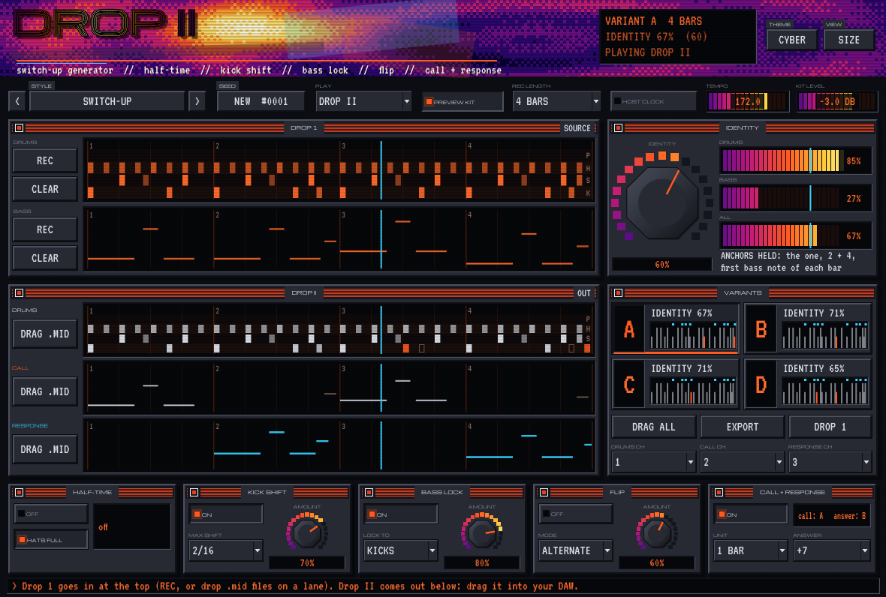

Give DROP II the drums and the bass of your first drop. It writes the second one: four
variants at a time, each made of five moves (**half-time**, **kick shift**, **bass lock**,
**register flip**, **call + response**) under one **IDENTITY** knob that decides how much of
drop 1 survives. Then it measures what actually survived, shows every note that moved, plays
the result live (MIDI out, or its own preview kit) and hands it to your DAW as `.mid` files by
drag and drop.

The idea comes from what DnB feedback threads keep saying about second drops: the same four
patterns again is boring, a different track is confusing. The usual answers (a half-time switch,
moving the kicks, locking the bass to the drums, a bass that answers itself) are all done by
hand. DROP II turns them into moves, and the balance between "same" and "new" into one knob.

---

## Contents

- [How it works](#how-it-works)
- [Quick start](#quick-start)
- [The interface](#the-interface)
  - [Header and toolbar](#header-and-toolbar)
  - [Drop 1](#drop-1)
  - [Drop II](#drop-ii-1)
  - [Identity](#identity)
  - [Variants](#variants)
  - [The moves](#the-moves)
- [Identity, in numbers](#identity-in-numbers)
- [Which note is the kick?](#which-note-is-the-kick)
- [Getting MIDI in and out](#getting-midi-in-and-out)
- [Styles](#styles)
- [Building](#building)
- [Tests](#tests)
- [Credits and licences](#credits-and-licences)

---

## How it works

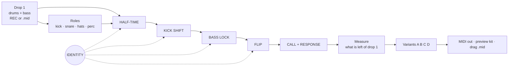

The moves run in that order on each of the four variants, every variant with its own dice. The
same settings and seed always give the same four variants.

---

## Quick start

1. Put DROP II on an instrument track. It starts with a demo drop and plays it as soon as the
   host plays (the standalone app runs its own clock).
2. Bring in your own drop 1: drag a drum clip and a bass clip from the DAW onto the **DRUMS** and
   **BASS** lanes of **DROP 1**, or arm **REC** on a lane and play the clip into the plug-in's
   MIDI input. Recording starts on the next bar and runs for **REC LENGTH**.
3. Pick a **STYLE**, or switch the moves on and off at the bottom.
4. Turn **IDENTITY**. Watch the meter: the knob is what you ask for, the bars are what is left.
5. Click through the variants **A – D**; **SEED** rolls four new ones.
6. Drag **DRAG .MID** (one lane) or **DRAG ALL** (one file, a track per lane) onto your DAW.
   **EXPORT** writes everything to `Music/DROP II`.

---

## The interface

### Header and toolbar

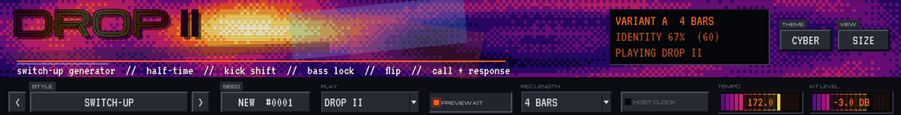

| Control | What it does |
|---|---|
| **Status screen** | The selected variant and its length; identity measured (and the knob, in brackets); what is playing, or what is armed / recording. |
| **STYLE** `<` `>` | Which moves are on and how hard ([styles](#styles)). Your drop 1, the seed, channels and the play settings stay. |
| **SEED** | Four new variants from the same settings. |
| **PLAY** | What plays while the host runs: OFF, DROP 1, DROP II (the selected variant). Switching between DROP 1 and DROP II is the A/B. |
| **PREVIEW KIT** | A small kit and two basses play along, so you hear drop 2 without routing MIDI. **MIDI ONLY** turns it off. |
| **REC LENGTH** | 1, 2, 4 or 8 bars. |
| **INT CLOCK** / **TEMPO** | Runs on its own clock when the host is stopped or absent. |
| **KIT LEVEL** | Level of the preview kit. |
| **THEME** / **VIEW** | The 13 themes shared with the other plug-ins; size, animation, GPU drawing. |

### Drop 1

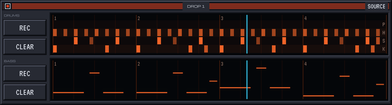

The source. **DRUMS** on four rows (**K**ick, **S**nare, **H**ats, **P**erc), **BASS** by pitch.

- **REC** arms the lane: the next bar of the MIDI input, for **REC LENGTH**, becomes this lane.
  Press again to disarm.
- **CLEAR** empties the lane.
- **Drop a `.mid` file** on a lane to load it. Two files at once: a name with *bass*, *reese* or
  *sub* goes to BASS, the other to DRUMS. A clip that starts at bar 9 of a song still starts at
  bar 1 here; its length is rounded up to whole bars.

Both lanes are saved inside the project.

### Drop II

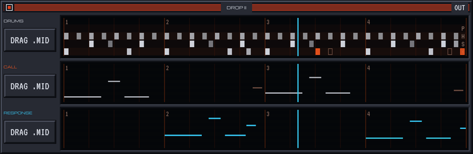

The selected variant: **DRUMS**, **CALL** (the bass, or its first voice) and **RESPONSE** (the
answering voice, when **CALL + RESPONSE** is on).

- A note that stayed is drawn plain; a note a move changed is lit (call in the accent colour,
  response in the second accent). An **outline** marks where drop 1 had a note that is no longer
  there.
- **DRAG .MID**: drag the button onto a track. It carries that lane of the selected variant as
  a `.mid` file.

### Identity

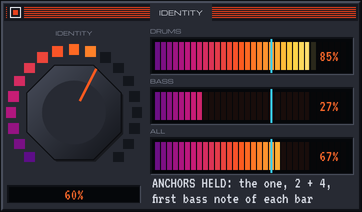

| | |
|---|---|
| **IDENTITY** | How much of drop 1 you want to keep. 100 % = drop 1 again; 0 % = everything the moves allow. |
| **DRUMS / BASS / ALL** | What is actually left, measured after generating (the line is the knob). |
| **Anchors** | From 25 % up, the anchors are held: the kick on the one of every bar, the snares on 2 and 4, the first bass note of every bar. That is what keeps drop 2 recognisable. Below 25 % they may move too. |

### Variants

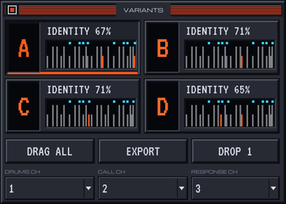

**A B C D**: four rolls of the same settings, each with its measured identity and a thumbnail
(kicks short, snares tall, lit = changed, dots = response notes). Click one to select it: the
DROP II lanes, the MIDI out and the drags all follow it.

**DRAG ALL** (one `.mid`, a track each for drums, call and response), **EXPORT** (all lanes and
each lane alone, time-stamped, into `Music/DROP II`), **DROP 1** (the source back as `.mid`).
**DRUMS CH / CALL CH / RESPONSE CH**: the MIDI channels of the lanes, for MIDI out and the files.

### The moves

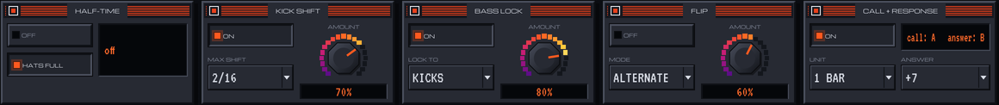

| Move | Controls | What it does |
|---|---|---|
| **HALF-TIME** | ON, **HATS FULL / HALF** | The later bars switch to half time: the kicks, snares and percussion of the first half of that stretch are played at half speed, so the snare lands on 3; the bass is stretched the same way. **IDENTITY** sets where it switches (the screen says which bar). With HATS FULL the hats keep running at full speed, so the 170 stays in the top. |
| **KICK SHIFT** | ON, **MAX SHIFT** (1 – 3 sixteenths), **AMOUNT** | Kicks slide off their places, more often later than earlier, never onto a snare or another kick. |
| **BASS LOCK** | ON, **LOCK TO** (kicks, or kicks + snares), **AMOUNT** | A bass note within half a beat of a kick moves onto it: the bass rides the drums. Notes are then cut so the bass stays one voice. |
| **FLIP** | ON, **MODE**, **AMOUNT** | Whole bars of bass change register: UP 8VA, DOWN 8VA, ALTERNATE (every other bar up), INVERT (mirrored around the lowest note, folded back into range). |
| **CALL + RESPONSE** | ON, **UNIT** (½, 1, 2 bars), **ANSWER** (unison, +3, +5, +7, +12, –5, –12) | The bass splits in two voices: every other unit becomes the answer, transposed, on its own lane and channel. In the preview kit the answer is a brighter pulse bass. |

**AMOUNT** is how many notes (or bars) a move touches at 0 % identity; identity scales it down
from there.

---

## Identity, in numbers

Each move touches a note with probability `(1 – identity) × amount × 1.3` (capped at 1).
Half-time instead switches at bar `round(identity × bars)`.

After generating, identity is **measured**: every hit goes on a 1/16 grid, and for each part the
overlap with drop 1 is taken (Jaccard: shared / all). Kick 30 %, snare 25 %, hats 10 %, perc 5 %,
bass 30 % (bass counts position *and* pitch, so a flipped bar is a different note). **ALL** is the
weighted mean of the parts that exist. With the demo drop, kick shift, bass lock and an octave
flip, the knob at 15 % measures about 43 % and the knob at 85 % about 89 % (averaged over 30
seeds; the tests check the gap).

## Which note is the kick?

General MIDI first: 35 / 36 kick, 37 – 40 snare, 42 / 44 / 46 / 51… hats. A clip that does not
use GM (a slicer's pads, a drum rack of your own) is read from the groove: the note heard most
on the one is the kick, the note heard most on beats 2 and 4 is the snare, and any other note
that plays at least once a beat is a hat. So drop 1 can come straight from BREAKSLICER or
BREAKMED.

## Getting MIDI in and out

| Way | How |
|---|---|
| Drop 1 from a clip | Drag the clip from the DAW onto a DROP 1 lane (most DAWs drag clips as `.mid` files), or REC from the MIDI input. |
| Hear drop 2 | **PREVIEW KIT** on: it plays inside the plug-in. |
| Play your own sounds | **MIDI ONLY**, then route DROP II's MIDI output to your drum and bass tracks (drums ch 1, call ch 2, response ch 3 by default). In Live: set the other tracks' *MIDI From* to this track. AU instruments have MIDI output in Logic and other hosts that support it. |
| Keep it | **DRAG .MID**, **DRAG ALL** or **EXPORT**. |

## Styles

| Style | Moves |
|---|---|
| SWITCH-UP | Kick shift + bass lock, identity 60 %: the default. |
| HALF-TIME DROP | Half-time from the middle, bass lock, no kick shift. |
| ROLLER FLIP | Alternate-bar octave flip, light kick shift. |
| CALL & RESPONSE | The bass answers itself a fifth up every other bar, locked to the kicks. |
| FULL VIP | Everything: half-time, inverted bars, a 2-bar answer an octave up, identity 30 %. |
| DROP 1 AGAIN | Identity 100 %: drop 1, to compare. |

---

## More themes

| | |
|---|---|
| 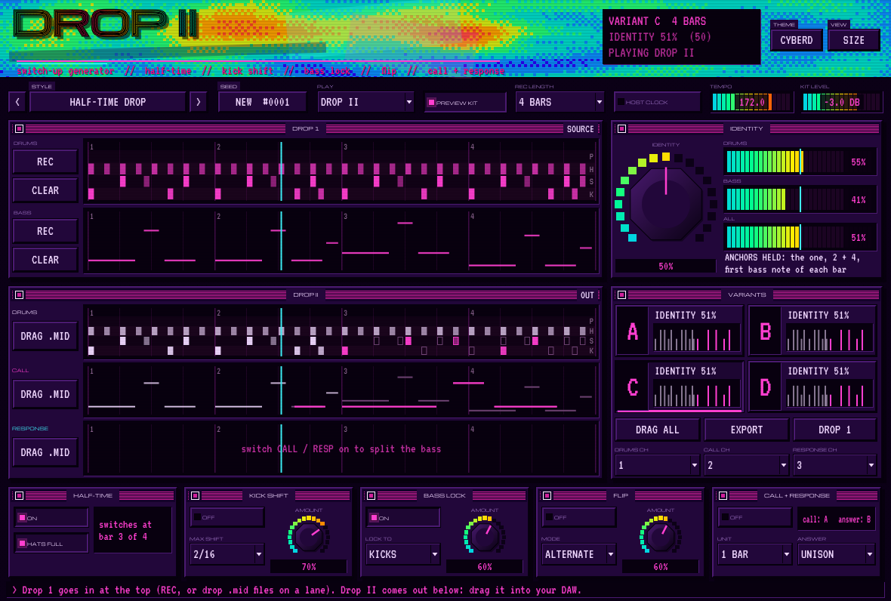 | 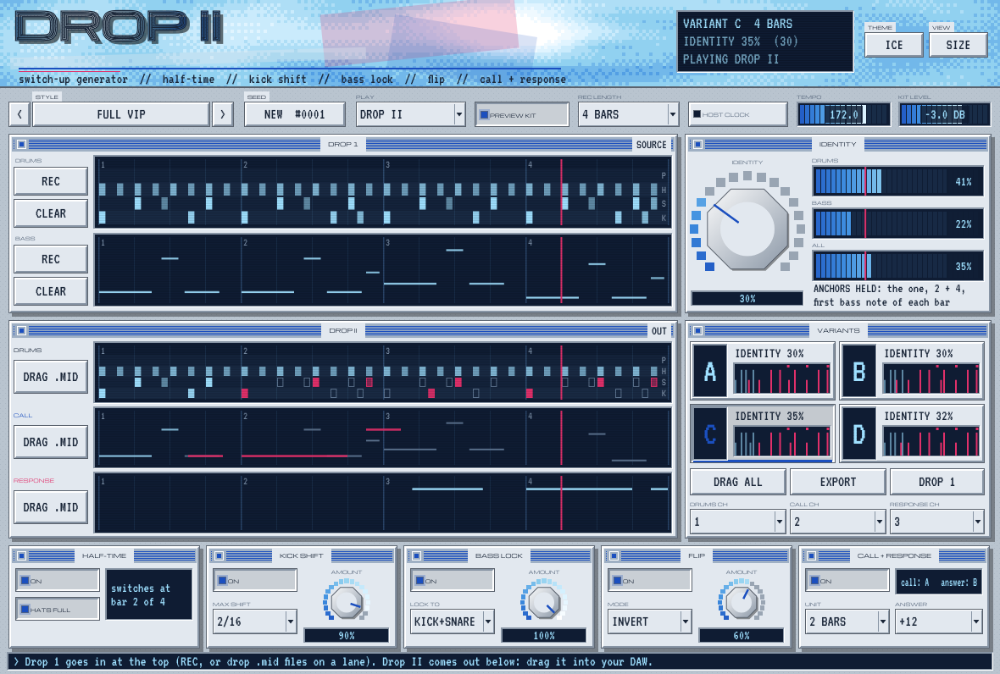 |
| 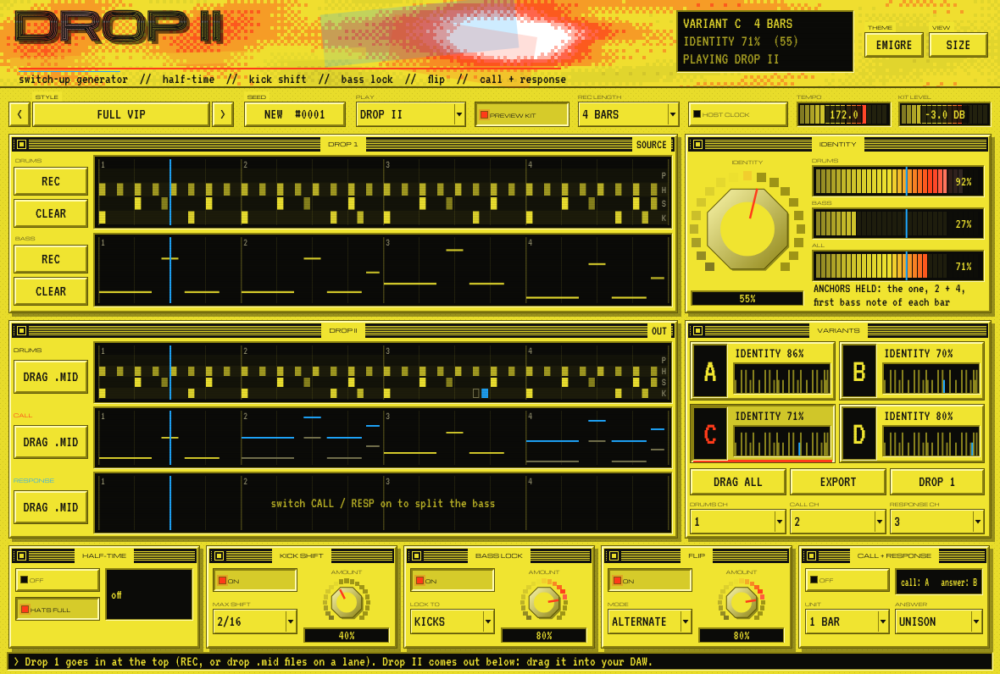 | |

---

## Building

C++20, JUCE 8 (fetched at configure time unless `-DJUCE_DIR=` points to a checkout).

```bash
cmake -B build -DCMAKE_BUILD_TYPE=Release
cmake --build build --config Release --parallel
ctest --test-dir build -C Release --output-on-failure
```

macOS builds AU, VST3 and the standalone app (universal); Windows and Linux build VST3 and
standalone. `-DDR2_BUILD_TOOLS=ON` adds `DropTwoSnapshot`, which renders the editor to PNG
without a display. `-DDR2_BUILD_PLUGIN=OFF` builds only the engine tests, no JUCE needed.
GitHub Actions builds all three systems, runs the tests and `auval`, and uploads the plug-ins.

## Tests

- `DropTwoEngineTests` (no JUCE): GM and pad-layout roles; identity 100 % leaves drop 1 alone
  and measures 1; kick shift never lands on a snare or another kick, keeps the kick count, keeps
  the one above 25 %; half-time puts the snare on 3 from the switch bar and keeps the hats;
  bass lock puts the bass on the kicks and leaves no overlaps; alternate flip and invert;
  call + response splits by unit and transposes; the identity knob moves the measurement;
  determinism.
- `DropTwoProcessorTests` (JUCE): the demo plays on channels 1 and 2, the kit is heard, no note
  is left hanging after stop; PLAY OFF is silent; the response comes on channel 3; REC captures
  one bar of kicks on the beat, starting on the next bar; `.mid` out and back in; the source
  clips survive the project state; every style gives four sane variants.

## Credits and licences

- Look shared with the sibling plug-ins (BREAKSLICER, TURNAROUND, MODPORT, IKEDAR…).
- Fonts (SIL OFL 1.1): Michroma, VT323 (`Resources/fonts`).
- JUCE 8 (AGPLv3 / commercial). Closed-source distribution needs a commercial JUCE licence.
